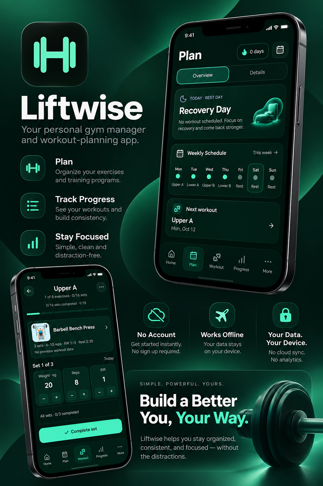

<div align="center">

# Liftwise

**Private workout planning. Local data. Built for iPhone.**

A personal fitness planner for building workout programs, organizing exercises, logging sessions, and tracking progress — without an account or cloud sync.

[**Open Liftwise**](https://liftwise-psi.vercel.app/) · [Roadmap](ROADMAP.md) · [Release notes](docs/RELEASE_NOTES_v1.2.1.md)



</div>

---

## Features

- **Workout planning** — create multiple programs, organize training days, choose a split, and set sets, rep ranges, RIR, rest times, and notes.
- **Exercise library** — search and filter exercises by body part or equipment, view instructions, and add custom exercises.
- **Workout tracking** — log sets and sessions, review workout history, personal records, and progress charts.
- **Home dashboard** — view your active program, suggested workout, weekly activity, and recent sessions.
- **Offline-first access** — use supported features offline after the app and required data have been cached.
- **Data portability** — create and validate backups, restore from a preview, export custom exercises to CSV, and inspect storage health.

## Install on iPhone

1. Open [Liftwise](https://liftwise-psi.vercel.app/) in **Safari** on your iPhone.
2. Tap **Share** → **Add to Home Screen**.
3. Keep the name as **Liftwise**, then tap **Add**.
4. Launch Liftwise from the Home Screen and stay online during the first launch so required files can load.

Supported features can then work offline. Offline availability depends on which app files and exercise media have been cached.

## Quick start

1. Browse the **Exercise Library** and create any missing custom exercises.
2. Open **Plan** and create a program.
3. Add training days and exercises.
4. Set your prescriptions, then reorder days and exercises as needed.
5. Start a workout and log your sets.

Saved programs and workout data are stored locally on your device.

## Privacy and storage

Liftwise is designed to keep personal fitness data on your device.

| Item | Current behavior |
| --- | --- |
| Account | Not required |
| Backend database / cloud sync | None |
| Analytics or tracking | None |
| Personal workout-data uploads | None |
| Main user-data storage | IndexedDB |
| Exercise media cache | Browser Cache Storage |

Liftwise does not currently send your programs, custom exercises, workout records, body metrics, or app settings to a Liftwise server.

### Backups matter

Browser storage is managed by the device and is **not guaranteed to be permanent**, even when persistence is granted. To create a backup, open **Settings → Data Safety → Create Backup** and store the downloaded JSON file somewhere safe.

Restore validates the backup and shows a preview before replacing data. The checksum helps detect accidental corruption; it is **not encryption or authentication**. Anyone who can read the backup file can read its contents.

Local data may be lost if you clear Safari/Liftwise website data, erase your device, remove browser-managed storage, switch to a different deployment address, or experience unexpected storage loss. There is no account or automatic cloud backup.

## Development

### Requirements

- Node.js **22+**
- pnpm **10** (`pnpm@10.15.1` is pinned)

### Commands

```bash
pnpm install
pnpm dev
```

Use the local URL printed by Vite. Service workers are disabled in development, so use a production build to test installation and offline behavior.

```bash
pnpm build
pnpm preview
pnpm build:deployment
pnpm check
pnpm test:e2e
```

`build:deployment` builds with optional RepDB media.

## Tech stack

React 19 · TypeScript · Vite · Tailwind CSS · React Router · IndexedDB · Dexie · Zod · React Hook Form · vite-plugin-pwa · Workbox · Vitest · React Testing Library · Playwright · ESLint · Prettier · pnpm

## Documentation

- [Architecture](docs/ARCHITECTURE.md)
- [Database](docs/DATABASE.md)
- [Backup and restore](docs/BACKUP_AND_RESTORE.md)
- [RepDB integration](docs/REPDB_INTEGRATION.md)
- [Third-party data](docs/THIRD_PARTY_DATA.md)
- [Testing](docs/TESTING.md)
- [iPhone testing](docs/IPHONE_TESTING.md)
- [Roadmap](ROADMAP.md)
- [Changelog](CHANGELOG.md)

## Status and limitations

Current release: **v1.2.1** — unified streak tracking, shared header, and iPhone layout refinements. Physical-iPhone acceptance and extended gym-use testing remain unverified. See the [v1.2.1 release notes](docs/RELEASE_NOTES_v1.2.1.md).

Accounts and cloud sync are not currently planned.

## License

Liftwise source code is licensed under the [MIT License](LICENSE). RepDB exercise data and artwork are third-party materials and are **not** covered by the Liftwise MIT license. See [RepDB integration](docs/REPDB_INTEGRATION.md), [third-party data](docs/THIRD_PARTY_DATA.md), and [RepDB](https://repdb.co).
